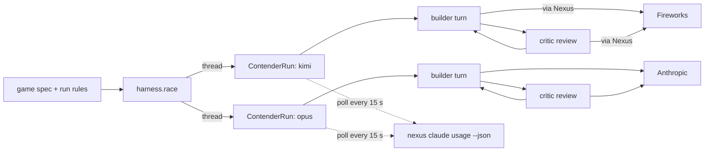

# The $100 GTA Build-Off: race harness

Two models get the same game brief and up to $100 each. Each builds the game alone in headless Claude Code, with a critic (a fresh copy of itself) reviewing every turn, until the game reaches the top tier or the money runs out. The harness keeps the race fair and records everything, so the results can be scored and turned into a video.

New here? [`HUMANS.md`](HUMANS.md) is the story version: the premise, the setup and why each rule exists. Coding agents start with [`AGENTS.md`](AGENTS.md).

The game is **Grand Theft GPU**, a browser heist game set in San Silicon, a parody of San Francisco: you steal GPUs, and the cast is satirical tech-Twitter archetypes. Both models start from the same three.js base game.

| | Kimi K3.1 Pro | Claude Opus 5.5 |
|---|---|---|
| Claude Code `--model` | `kimi-k3p1-pro` | `claude-opus-5-5` |
| Served by | Fireworks, through Nexus | Anthropic |
| Spend counted by | Nexus | Nexus |

## Setup (fresh clone)

1. **Install the tools:** macOS, [uv](https://docs.astral.sh/uv/), [Claude Code](https://claude.com/claude-code) 2.1.281+, Node.js, and the Nexus CLI (`curl -fsSL https://nexus.fireworks.ai/install.sh | bash`). Blender only if you'll rebuild the props.
2. **Python environment** (3.12, pinned in `.python-version`):
   ```bash
   uv sync
   uv run playwright install chromium
   ```
3. **Connect Nexus:** `nexus login`, then `nexus claude`. This routes Claude Code to Fireworks for the Kimi side.
4. **Check everything:** `uv run buildoff doctor` (prints `ok` or a fix per prerequisite) and `uv run pytest` (free, seconds).
5. **Smoke test** (about $2–4): both models add a floating GPU to the base game, then each gets one critic review.
   ```bash
   uv run buildoff smoke
   ```

Assets download from Hugging Face on the first race (about 650 MB, cached). See [Assets](#assets).

## Run a race

There are two races, run side by side and compared: the **full-assets** race (about 1,300 ready-made assets) and the **primitives** race (only the GPU model; everything else made in code).

```bash
nohup uv run buildoff race --budget 100 --yes --pack full       --race-id full-001 > ~/gta-race-runs/full-001.log 2>&1 &
nohup uv run buildoff race --budget 100 --yes --pack primitives --race-id prim-001 > ~/gta-race-runs/prim-001.log 2>&1 &
```

`--yes` is required above $2, because a race spends up to that amount **per model**. Races take hours; the harness keeps the Mac awake itself (keep it plugged in with the lid open). Live viewer windows open in Terminal; `--no-viewers` skips them.

Follow and play (free, read-only):

```bash
uv run buildoff status                     # progress as JSON: turns, spend, critic tiers, stop reason
uv run buildoff reviews                    # every critic round: tier, notes, checks, cost, screenshots
nexus claude usage --session <session_id>  # live per-request tokens and cost for one model
uv run buildoff play opus                  # open a model's latest build in your browser
uv run buildoff stop                       # end a race early, cleanly
```

## How a race works



Each contender loops through rounds:

1. **Seeding** (before the clock starts): its own copy of the base game at a pinned commit, the pack's assets at `public/assets/gt-gpu/`, `tools/screenshot` and (full pack) `tools/assets.mjs`, then `npm ci`. Turn 0 records the untouched base game.
2. **Builder turn:** one `claude -p` process that resumes the same session every turn. Turn 1 gets the spec plus the run rules; later turns get the critic's notes. It runs until the model stops (a Stop hook won't let it stop on an announcement or a broken build).
3. **Evidence:** the harness commits the workspace to `history.git` (outside the model's reach), builds it, screenshots gameplay, and logs a row in `turns.jsonl`. A turn is **playable** if it built, loaded and rendered with no uncaught exception.
4. **Critic review:** a fresh session of the *same* model, with no memory of building, plays the game read-only, compares it with the brief and tier ladder (`prompts/critic.md`), and ends with a verdict: tier reached, Tier 4 complete or not, and notes. The notes become the builder's next prompt (`prompts/nudge.md`). The harness copies the critic's screenshots to `shots/critic-NNN/` and logs the review's own cost and time. A review at max effort can take about an hour.
5. **Tier 4 check:** if the critic says Tier 4, the harness's own checks (`harness/checks.py`) must agree: the game is playable, the city moves with no input, and the critic's daylight and night screenshots clearly differ. Then the run ends as `tier4`. If not, the failures are added to the critic's notes.

**Throughout,** a watchdog polls Nexus every 15 seconds and stops the run if total spend (builder and critics) reaches the budget, any other model shows up (`leak`), or Nexus goes quiet for 3 minutes (`meter_down`). A session with no output and no new spend for 10 minutes is cut short (`stalled`) and goes to review. Provider API errors and cut-off streams are retried (up to 3 per run). The smoke test stops at the first `DONE.md`, after one review.

## Rules of the race

- **Only the model differs.** Both sides get the same flags, tools (Bash, Read, Edit, Write, WebFetch, WebSearch, Agent), files and Claude Code settings: every model slot and subagent pinned to the side's own model, the same reasoning effort and compaction point, the same Stop hook, and one read-only `playtester` subagent each may call (`harness/session.py`).
- **Nexus is the referee.** Claude Code misprices Kimi (about 2x list), so all spend comes from `nexus claude usage` at list price, subagents and critics included.
- **Sealed off.** Each model runs in its own macOS sandbox (`harness/sandbox.py`): it can read and write only its own workspace, not the other model's, the logs, earlier races, this repo or other sessions' transcripts. The critic's sandbox is read-only. API keys are stripped from the environment, and the user's MCP servers and skills are switched off.
- **Fails closed.** Ctrl-C, `kill` or `buildoff stop` ends both sides within a second (`aborted`); a harness crash still kills the running session and writes `result.json`.
- **No screen recording.** Every transcript line carries a race-clock timestamp, and the video is rendered from the logs.
- **Expect a small budget overshoot:** up to about 15 seconds of spend past the cap.

## What a race leaves behind

```
~/gta-race-runs/<race-id>/
├── config.json, summary.json
└── kimi/ | opus/
    ├── workspace/             the game the model built
    ├── history.git/           one commit per turn (git --git-dir=history.git log)
    ├── toolkit/               what ran inside the sandbox: screenshot tool, Stop hook, settings
    ├── logs/turn-NNN.jsonl    builder transcript, each line {"t": seconds, "event": ...}
    ├── logs/critic-NNN.jsonl  critic transcript after turn NNN
    ├── logs/reviews.jsonl     each review: tier, Tier 4 claim, check results, notes, its own cost and time
    ├── logs/turns.jsonl       per turn: commit, cost, build_ok, loaded, playable, errors
    ├── logs/cost.csv          seconds,total_cost_usd at every Nexus poll
    ├── logs/events.jsonl      leaks, stalls, meter, aborts, retries, harness errors (if any)
    ├── shots/turn-NNN.png     gameplay screenshot after each turn (000 = base game)
    ├── shots/critic-NNN/      the screenshots the critic took reviewing turn NNN
    └── result.json            stop reason, cost, turns, reviews, last tier, model time
```

## Assets

All assets live in the Hugging Face dataset **[harpreetsahota/grand-theft-gpu-assets](https://huggingface.co/datasets/harpreetsahota/grand-theft-gpu-assets)** (about 1 GB, every folder with its license and attribution). This repo tracks only `assets/catalog.json`, the index of all 1,302 assets, pinned to the dataset revision races use (`HF_ASSETS_REVISION` in `harness/config.py`).

| Folder | What | License |
|---|---|---|
| `rocketbox-avatars/` | 105 rigged people: business, police, medical, fire, construction, security, everyday adults | MIT (Microsoft Rocketbox) |
| `rocketbox-motions/` | 326 motion-capture clips that play on any Rocketbox person | MIT (Microsoft Rocketbox) |
| `quaternius-animations/` | 89 walk/run/drive/climb clips on one humanoid rig | CC0 (Quaternius) |
| `sf-city/` | Real SF slice (SoMa → FiDi → Embarcadero): terrain, 2,168 buildings, streets, bay, street graph | ODbL / © OpenStreetMap contributors |
| `vehicles-objaverse/`, `vehicles-quaternius/` | 15 realistic low-poly vehicles at real size, all facing +z | CC-BY 4.0 (per-artist credit) / CC0 |
| `kenney/` | 664 low-poly city pieces and furniture | CC0 (Kenney) |
| `usdcraft-props/` | 45 props with joints: servers, safes, an ATM, a forklift, a drone | Apache 2.0 (NVIDIA USDCraft-10K) |
| `gpu/` | The loot: a graphics card with animatable fans and RGB | CC0 (Grab3D) |
| `meta-mhr/` | Meta's parametric human body, 7 LODs (on demand only) | Apache 2.0 (Meta) |
| `trees-google-poly/` | 8 street trees and palms, at real heights | CC-BY 3.0 (per-artist credit) |
| `polyhaven-hdris/`, `polyhaven-textures/`, `ambientcg-textures/` | 8 HDRI skies; 36 PBR materials including day/night office facades | CC0 |
| `audio-opengameart/`, `audio-freesound/`, `kenney-media/` | Engines, tires, sirens, crashes, horn, traffic, footsteps, impacts, UI sounds; particle sprites | CC0 / CC-BY 3.0 per item |
| `google-fonts/` | Bebas Neue, Anton, Rajdhani, Share Tech Mono | OFL 1.1 |

**In a race,** a full-pack workspace is seeded with the web tier (about 650 MB: everything except people's extra LOD/mobile/collision tiers, 2k skies and the MHR bodies). A primitives workspace gets only `gpu/`. The base game is [kartik786-git/gta-clone-threejs](https://github.com/kartik786-git/gta-clone-threejs), used with attribution and fetched at a pinned commit.

**Search and fetch** (JSON out, deterministic, agent-friendly):

```bash
uv run buildoff inventory schema                     # what every field and command means
uv run buildoff inventory search police car --limit 3
uv run buildoff inventory show usdcraft-props/home-safe
uv run buildoff fetch rocketbox-avatars/chef-female-01 --tiers
uv run buildoff fetch --pattern 'meta-mhr/*'
```

Errors go to stderr as `{"error": ..., "hint": ...}`, with exit code 1 (not found) or 2 (bad input).

**Rebuild and publish the dataset** (stages into `~/grand-theft-gpu-assets/`):

```bash
uv run buildoff assets mirror      # third-party sets at pinned revisions (scripts/mirror_sources.json)
uv run buildoff assets city        # SF slice from OpenStreetMap + elevation
uv run buildoff assets textures    # skies and PBR materials
uv run buildoff assets media       # sounds, sprites, fonts
uv run buildoff assets props       # USDCraft props → .glb via Blender (scripts/convert_usdcraft.py)
uv run buildoff assets dataset     # license, attribution and dataset card
uv run buildoff assets catalog     # rebuild assets/catalog.json
uv run buildoff assets publish     # upload: public, only after a human reviews the cards
```

Every download is pinned (revision, date or sha256), and an unchanged rebuild of the catalog is byte-identical.

## Code map

| File | Job |
|---|---|
| `harness/cli.py` | The `buildoff` command |
| `harness/race.py` | Runs both contenders in parallel; abort, keep-awake, `stop` |
| `harness/runner.py` | One contender: builder turn, evidence, critic review, Tier 4 check, watchdog |
| `harness/checks.py` | The harness's own Tier 4 checks |
| `harness/session.py`, `harness/stop_hook.py` | Per-side Claude Code settings, Stop hook, playtester subagent |
| `harness/sandbox.py` | Per-side `sandbox-exec` profiles and the scrubbed environment |
| `harness/seed.py` | Seeds each workspace |
| `harness/snapshot.py` | Per-turn commit, Vite build and gameplay screenshot |
| `harness/meter.py` | Reads cost and models from Nexus |
| `harness/status.py`, `harness/viewer.py` | `status`, `reviews`, `play`, and the live terminal viewer |
| `harness/shot_tool.py`, `harness/workspace_tools/assets.mjs` | The models' screenshot and asset tools |
| `harness/config.py` | Contenders, limits, paths, pinned commits and revisions |
| `harness/doctor.py` | Prerequisite checks |
| `harness/catalog.py`, `inventory.py`, `fetch.py` | The asset catalog, its search, and downloads |
| `harness/mirror.py`, `sfcity.py`, `textures.py`, `media.py`, `dataset.py`, `assets.py` | Building the asset dataset |
| `scripts/` | Blender converters and pinned source lists |
| `prompts/` | The locked game specs, run rules, critic prompt and nudge template (tag `prompt-v7`) |
| `tests/` | The local test suite |

## Not done yet

- The per-tier scoring checklist, locked before the race, and the blind judging.
- The Claude side bills through a Claude login; a strict "list price" claim needs an Anthropic API key in Nexus.
- Rendering the race video from the logs.

## License

The harness code and docs are under the [Business Source License 1.1](LICENSE). Non-commercial use is free, including replicating, studying, benchmarking, running your own model races and publishing the results. Commercial use needs a separate license. The code converts to Apache 2.0 on 2040-01-22, or on the fourth anniversary of each version's release, whichever comes first.

Why 2040-01-22? It's **4,811 days** after this repo went public, exactly how long fans waited between GTA V (Sept 17, 2013) and GTA 6 (Nov 19, 2026). The license's own four-year rule means the code opens up sooner, but the date stays as a tribute.

The assets keep their own licenses, listed per folder in the [asset dataset](https://huggingface.co/datasets/harpreetsahota/grand-theft-gpu-assets#licenses-and-credit). The base game is fetched from [its author's repo](https://github.com/kartik786-git/gta-clone-threejs) at run time and isn't redistributed here.
