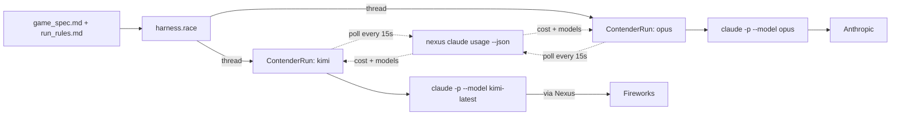

# The $100 GTA Build-Off: race harness

Two models get the same game spec and the same $100. Each one builds the game alone in headless Claude Code. The harness records everything so the results can be scored and turned into a video.

New here? [`HUMANS.md`](HUMANS.md) is the story version: the premise, the setup, and why each rule exists. Coding agents should start with [`AGENTS.md`](AGENTS.md).

The game is **Grand Theft GPU**, a browser heist game set in San Silicon, a parody of San Francisco: you steal GPUs, and the cast is satirical tech-Twitter archetypes. Both models start from the same three.js base game and the same asset pack (below).

| | Kimi K3.1 Pro | Claude Opus 5.5 |
|---|---|---|
| Claude Code `--model` | `kimi-latest` | `opus` |
| Served by | Fireworks, through Nexus | Anthropic |
| Spend counted by | Nexus | Nexus |

## Setup (fresh clone)

1. **Install the tools:**
   - [uv](https://docs.astral.sh/uv/)
   - [Claude Code](https://claude.com/claude-code) 2.1.242+
   - Node.js, for the base game's Vite build
   - Nexus CLI: `curl -fsSL https://nexus.fireworks.ai/install.sh | bash`
   - Blender, only if you'll rebuild the props: `brew install --cask blender`
2. **Python environment** (Python 3.12, pinned in `.python-version`; one sync installs every group):
   ```bash
   uv sync
   uv run playwright install chromium
   ```
3. **Connect Nexus:** `nexus login`, then `nexus claude`. This routes Claude Code to Fireworks for the Kimi side.
4. **Check everything:** `uv run buildoff doctor`. It prints `ok` or a fix for each prerequisite.
5. **Smoke test** (about $0.30, 2 minutes). Both models add a floating GPU to the base game:
   ```bash
   uv run buildoff smoke
   ```

The assets download from Hugging Face automatically on the first race (about 517 MB, cached). See [Assets](#assets).

## Run a race

```bash
uv run buildoff race --budget 100 --yes
```

`--yes` is required for any budget over $2, because a race spends up to that amount **per model**. Live viewer windows open in Terminal; pass `--no-viewers` to skip them, for example when not on macOS. Using an AI agent? Point it at [`AGENTS.md`](AGENTS.md).

Follow it and play the results (free, read-only):

```bash
uv run buildoff status                     # progress as JSON: turns, spend, stop reason, Nexus session
nexus claude usage --session <session_id>  # live per-request tokens and cost for one model
uv run buildoff play opus                  # open a model's latest build in your browser
```

[HUMANS.md](HUMANS.md) explains each one, and how Nexus routes Kimi through Claude Code.

## How a race works



Each contender loops through turns. A turn is one `claude -p` process.

0. **Seeding** (before the clock starts): the workspace gets the base game at a pinned commit, our assets at `public/assets/gt-gpu/`, and a clean `npm install`. Turn 0 records the untouched base game.
1. **Turn 1** gets the spec plus the run rules. Every later turn gets the same fixed nudge (`prompts/nudge.md`) and resumes the same session.
2. **During a turn,** a watchdog polls Nexus every 15 seconds. It kills the turn if spend reaches the budget, if any model other than the contender's shows up (a leak), if Nexus gives no reading for 3 minutes (`meter_down`: the budget can't be enforced blind), or if the turn **stalls**: no output and no new spend for 10 minutes. A stalled turn isn't a penalty; the model gets nudged and carries on. This exists because a model in a dry run started `npm run preview`, a server that never exits, in the foreground and sat blocked for 35 minutes.
3. **After every turn,** the harness kills the turn's process group and any server the model left running in its workspace, then commits the workspace to `history.git` (outside the model's reach), runs `npm install && npm run build`, screenshots the built game, and writes a row to `turns.jsonl`. The screenshot waits for the game to finish loading, then clicks past any "click to play" screen, so it shows gameplay. A turn is **playable** if it built, loaded and rendered with no uncaught exception. Console errors (a missing favicon, a logged warning) are recorded but don't fail a turn. The race clock (`model_seconds`, `elapsed_s`) counts only time the model's turns ran, not the harness's own build and screenshot work.
4. **Stop rules,** in order: budget, leak, dead meter, abort or crash → 3 nudges used. Creating `DONE.md` early doesn't end a race: the file is set aside in `logs/done-turn-NNN.md` and the model gets the fixed nudge, so both models are pushed toward the full budget the same way. A `DONE.md` after the last nudge ends the run (`declared_done`). The smoke test stops at the first `DONE.md`. A provider API error (such as a dropped stream) isn't the model's fault: the session is resumed with the nudge, up to 3 times per run, without using up a nudge, and logged as `api_retry` in `logs/events.jsonl`.

## Rules of the race

These are the decisions behind the design.

- **Nexus is the referee.** Claude Code misprices Kimi (it showed 2x list price), so all spend comes from `nexus claude usage`, at list price, with subagents included.
- **Same harness on both sides.** Both get identical flags; only `--model` changes.
- **Same tools on both sides:** Bash, Read, Edit, Write, WebFetch, WebSearch, Agent.
- **Subagents are pinned per process** (`CLAUDE_CODE_SUBAGENT_MODEL`), so a Kimi subagent can't fall back to Claude. A leak test confirmed it, and the watchdog checks it on every poll.
- **Isolated from your setup:** no MCP servers, no skills or slash commands, and workspaces live in `~/gta-race-runs/`, outside this repo.
- **Isolated from each other:** each turn runs under a macOS `sandbox-exec` profile (`harness/sandbox.py`). A model can read and write only its own workspace. It can't read the other model's game, the race logs and evidence, earlier races, this repo, or other sessions' transcripts. Its environment is scrubbed of API keys and tokens.
- **Same Claude Code config on both sides** (`harness/session.py`): every model tier and subagent pinned to the side's own model, the same reasoning effort and compaction point, a Stop hook that keeps a model working when it stops mid-promise or on a broken build (its reason is the locked nudge), and one read-only `playtester` subagent each model may call.
- **Fails closed:** Ctrl-C, `kill` or `buildoff stop` aborts both sides within a second (`aborted`). A harness crash still kills the running turn and writes `result.json`.
- **No screen recording.** Every transcript line carries a race-clock timestamp, and the video is rendered later from the logs. Nothing private ends up on camera.
- **Budget overshoot is expected:** up to about 15 seconds of spend past the cap.
- **Unpriced rows only produce a warning.** If Nexus can't price a call, a warning goes to `events.jsonl` and the race continues.

## What a race leaves behind

```
~/gta-race-runs/<race-id>/
├── config.json, summary.json
└── kimi/ | opus/
    ├── workspace/            the game the model built
    ├── history.git/          one commit per turn of workspace/ (git --git-dir=history.git log)
    ├── logs/turn-NNN.jsonl   transcript, each line {"t": seconds, "event": ...}
    ├── logs/cost.csv         seconds,cost_usd from each Nexus poll
    ├── logs/turns.jsonl      per turn: end, commit, cost, build_ok, loaded, playable, errors
    ├── logs/events.jsonl     leaks, stalls, meter, aborts, retries, harness errors (only if any)
    ├── shots/turn-NNN.png    gameplay screenshot after each turn (000 = base game)
    └── result.json           stop reason, cost, turns, model time, first playable turn
```

## Assets

All assets live in the Hugging Face dataset **[harpreetsahota/grand-theft-gpu-assets](https://huggingface.co/datasets/harpreetsahota/grand-theft-gpu-assets)**, not in this repo. This repo tracks only `assets/catalog.json`, the index of all 1,302 assets, pinned to the dataset revision races use (`HF_ASSETS_REVISION` in `harness/config.py`).

| Folder | What | License |
|---|---|---|
| `rocketbox-avatars/` | 105 rigged people: business, police, medical, fire, construction, security, everyday adults | MIT (Microsoft Rocketbox) |
| `rocketbox-motions/` | 326 motion-capture clips that play on any Rocketbox person | MIT (Microsoft Rocketbox) |
| `quaternius-animations/` | 89 walk/run/drive/climb clips on one humanoid rig | CC0 (Quaternius) |
| `sf-city/` | Real SF slice (SoMa → FiDi → Embarcadero): terrain, 2,168 buildings, streets, bay, street graph | ODbL / © OpenStreetMap contributors |
| `vehicles-objaverse/`, `vehicles-quaternius/` | 15 realistic low-poly vehicles at real size, all facing +z: police sedan, taxis, compact cars, SUV, muscle cars, vans, ambulance, fire truck, city bus | CC-BY 4.0 (per-artist credit) / CC0 |
| `kenney/` | 664 low-poly city pieces and furniture | CC0 (Kenney) |
| `usdcraft-props/` | 45 props with joints: servers, safes, an ATM, a forklift, a drone | Apache 2.0 (NVIDIA USDCraft-10K) |
| `gpu/` | The loot: a graphics card with animatable fans and RGB | CC0 (Grab3D) |
| `meta-mhr/` | Meta's parametric human body, 7 LODs (on demand only) | Apache 2.0 (Meta) |
| `trees-google-poly/` | 8 street trees and palms, at real heights | CC-BY 3.0 (per-artist credit) |
| `polyhaven-hdris/`, `polyhaven-textures/`, `ambientcg-textures/` | 8 HDRI skies (1k seeded, 2k on demand); 36 PBR materials incl. day/night office facades | CC0 (Poly Haven, ambientCG) |
| `audio-opengameart/`, `audio-freesound/`, `kenney-media/` | Engine, tires, police and ambulance sirens, crashes, horn, traffic ambience, alarm, footsteps, impacts, UI sounds; particle sprites | CC0 / CC-BY 3.0 per item (credited) |
| `google-fonts/` | Bebas Neue, Anton, Rajdhani, Share Tech Mono | OFL 1.1 |

**In a race,** every workspace is seeded with the full web tier (about 650 MB: everything except people's extra LOD/mobile/collision tiers, 2k skies and the MHR bodies), copied from the Hugging Face cache into `public/assets/gt-gpu/` in the dataset's layout. Each workspace also gets `tools/assets.mjs`, a zero-dependency Node tool the models use to search the catalog and fetch extras (`node tools/assets.mjs help`), and `tools/screenshot`, which builds and renders the game to a PNG the model can look at.

**Fetch assets yourself:**

```bash
uv run buildoff fetch rocketbox-avatars/chef-female-01 --tiers   # one person, all tiers
uv run buildoff fetch --core --out /tmp/core                     # the seeded set
uv run buildoff fetch --pattern 'meta-mhr/*'                     # any dataset glob
```

The base game is [kartik786-git/gta-clone-threejs](https://github.com/kartik786-git/gta-clone-threejs), used with attribution and fetched at a pinned commit.

### The asset dataset on Hugging Face

All game assets, including the people, motion clips, city kits and a real San Francisco slice, live in **[harpreetsahota/grand-theft-gpu-assets](https://huggingface.co/datasets/harpreetsahota/grand-theft-gpu-assets)** (about 1 GB, every folder with its license and attribution). It's built and published with:

```bash
uv run buildoff assets mirror    # third-party sets at pinned revisions (scripts/mirror_sources.json)
uv run buildoff assets city      # SF slice from OpenStreetMap + elevation (harness/sfcity.py)
uv run buildoff assets dataset   # attribution files + dataset card (dataset_card/)
uv run buildoff assets publish   # upload (only after a human reviews the cards)
```

These stage into `~/grand-theft-gpu-assets/`.

### Searching the assets

Every asset is listed in `assets/catalog.json`: id, category, kind, URL, whether it's seeded, size in metres, triangles, movable parts, joints, animation clips, tags and license. `buildoff inventory` searches it. It doesn't prompt, it's deterministic, and it prints JSON, so agents can use it directly:

```bash
uv run buildoff inventory schema                     # what every field and command means
uv run buildoff inventory categories                 # counts per category
uv run buildoff inventory search police car --limit 3
uv run buildoff inventory list --tag heist-target --format jsonl
uv run buildoff inventory show usdcraft-props/home-safe   # full record: parts, joints, size
```

Errors go to stderr as `{"error": ..., "hint": ...}`, with exit code 1 (not found) or 2 (bad input). Rebuild the catalog after re-publishing the dataset with `uv run buildoff assets catalog` (it reads the local staging copy).

### Rebuilding our own asset sets

The GPU and USDCraft props are the two sets we build ourselves; they go into the dataset via `buildoff assets dataset`.

```bash
uv run buildoff assets                     # all sets + catalog; or: gpu | cars | props | catalog
uv run buildoff assets props --out /tmp/x  # rebuild somewhere else, then diff
```

- **gpu / cars:** downloaded from Grab3D and Kenney.
- **props:** downloads the 45 folders listed in `scripts/usdcraft_props.csv` from Hugging Face (about 120 MB) and converts them with `scripts/convert_usdcraft.py` inside Blender. Set `$BLENDER` if Blender isn't at `/Applications/Blender.app`.

USDCraft ships OpenUSD for Isaac Sim, which three.js can't load. For each prop, the converter drops the collision meshes, caps each mesh at 4K triangles, keeps moving parts as separate nodes, writes the joints to `manifest.json`, and exports a Y-up `.glb`. To change the prop set, edit `scripts/usdcraft_props.csv`; categories and paths come from the dataset's `manifest.csv`.

## Code map

| File | Job |
|---|---|
| `harness/race.py` | CLI entry: runs the contenders in parallel and writes the summary |
| `harness/runner.py` | One contender: turn loop, watchdog, stop rules |
| `harness/sandbox.py` | Per-contender `sandbox-exec` profile and scrubbed environment |
| `harness/meter.py` | Reads cost and models from Nexus |
| `harness/status.py` | `buildoff status` and `buildoff play`: race progress as JSON, serve a build |
| `harness/snapshot.py` | Per-turn git commit, Vite build, and gameplay screenshot |
| `harness/viewer.py` | Live terminal view of a contender (`python -m harness.viewer <dir>`) |
| `harness/config.py` | Contenders, limits, paths |
| `prompts/` | Game spec, run rules, nudge, smoke spec |
| `harness/cli.py` | The `buildoff` command (doctor, assets, smoke, race) |
| `harness/seed.py` | Seeds each workspace with the base game (pinned commit) and assets |
| `harness/doctor.py` | Checks every prerequisite and prints how to fix what's missing |
| `harness/assets.py` | Rebuilds `assets/` from the original sources |
| `harness/catalog.py` | Builds `assets/catalog.json` by inspecting every `.glb` |
| `harness/inventory.py` | The `buildoff inventory` search and query layer |
| `harness/fetch.py` | `buildoff fetch` and the seeded core set (`CORE_PATTERNS`) |
| `harness/workspace_tools/assets.mjs` | The racing models' search + fetch tool (copied into every workspace) |
| `harness/shot_tool.py` | `tools/screenshot` in every workspace: build + render the game to a PNG the model can look at |
| `harness/cliutil.py` | Shared JSON usage-error parser for agent-facing CLIs |
| `harness/mirror.py`, `scripts/mirror_sources.json` | Mirror pinned third-party asset sets (Rocketbox, Kenney) |
| `harness/sfcity.py` | Builds the real SF slice: terrain, buildings, streets, street graph |
| `harness/dataset.py`, `dataset_card/` | Assemble and publish the Hugging Face asset dataset |
| `scripts/convert_mhr.py` | Meta MHR body FBX → glb (runs in Blender) |
| `scripts/convert_usdcraft.py` | USDCraft OpenUSD → `.glb` converter (runs in Blender) |
| `scripts/usdcraft_props.csv` | The curated list of 45 USDCraft props |
| `assets/` | GPU, cars and props the models build with |

## Not done yet

- The detailed pass/fail checks per tier (T1 steal a GPU → T4 living San Silicon) for scoring commits. The game prompts are locked (git tag `prompt-v5`).
- The Claude side bills through your Claude login. For a true "list price" claim, give Nexus an Anthropic API key.
- Rendering the race video from the logs.
- More assets for prompt-v3: people (Quaternius, Microsoft Rocketbox, Meta MHR) and a real SF slice from OpenStreetMap. A dry run showed the models build every pedestrian from boxes when they're given no people.

## License

The harness code and docs are under the [Business Source License 1.1](LICENSE). Non-commercial use is free, including replicating, studying, benchmarking, running your own model races and publishing the results. Commercial use needs a separate license. The code converts to Apache 2.0 on 2040-01-22, or on the fourth anniversary of each version's release, whichever comes first.

Why 2040-01-22? It's **4,811 days** after this repo went public, which is exactly how long fans waited between GTA V (Sept 17, 2013) and GTA 6 (Nov 19, 2026). The license's own four-year rule means the code actually opens up sooner, but the date stays as a tribute.

The assets keep their own licenses, listed per folder in the [asset dataset](https://huggingface.co/datasets/harpreetsahota/grand-theft-gpu-assets#licenses-and-credit). The base game is fetched from [its author's repo](https://github.com/kartik786-git/gta-clone-threejs) at run time and isn't redistributed here.
