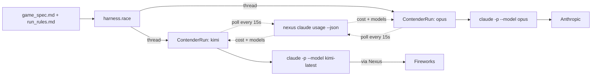

# The $100 GTA Build-Off: race harness

Two models get the same game spec and the same $100. Each one builds the game alone in headless Claude Code. The harness records everything so the results can be scored and turned into a video.

| | Kimi K3.1 Pro | Claude Opus 5.5 |
|---|---|---|
| Claude Code `--model` | `kimi-latest` | `opus` |
| Served by | Fireworks, through Nexus | Anthropic |
| Spend counted by | Nexus | Nexus |

## Run a race

```bash
uv sync && uv run playwright install chromium   # once

# real race
uv run python -m harness.race --spec prompts/game_spec.md --budget 100

# cheap smoke test, no viewer windows
uv run python -m harness.race --spec prompts/smoke_spec.md --budget 0.5 --no-viewers
```

Needs: macOS, `claude` 2.1.242+, `nexus claude` connected (`nexus claude status`), and `uv`.

## How a race works



Each contender loops through turns. A turn is one `claude -p` process.

1. **Turn 1** gets the spec plus the run rules. Every later turn gets the same fixed nudge (`prompts/nudge.md`) and resumes the same session.
2. **During a turn,** a watchdog polls Nexus every 15 seconds. It kills the turn if spend reaches the budget, or if any model other than the contender's shows up (a leak).
3. **After every turn,** the harness makes a git commit, takes a headless screenshot of `index.html`, and writes a row to `turns.jsonl`.
4. **Stop rules,** in order: budget, leak or crash → the model created `DONE.md` → 3 nudges used.

## Rules of the race

These are the decisions behind the design.

- **Nexus is the referee.** Claude Code misprices Kimi (it showed 2x list price), so all spend comes from `nexus claude usage`, at list price, with subagents included.
- **Same harness on both sides.** Both get identical flags; only `--model` changes.
- **Same tools on both sides:** Bash, Read, Edit, Write, WebFetch, WebSearch, Agent.
- **Subagents are pinned per process** (`CLAUDE_CODE_SUBAGENT_MODEL`), so a Kimi subagent can't fall back to Claude. A leak test confirmed it, and the watchdog checks it on every poll.
- **Isolated from your setup:** no MCP servers, no skills or slash commands, and workspaces live in `~/gta-race-runs/`, outside this repo.
- **No screen recording.** Every transcript line carries a race-clock timestamp, and the video is rendered later from the logs. Nothing private ends up on camera.
- **Budget overshoot is expected:** up to about 15 seconds of spend past the cap.
- **Unpriced rows only produce a warning.** If Nexus can't price a call, a warning goes to `events.jsonl` and the race continues.

## What a race leaves behind

```
~/gta-race-runs/<race-id>/
├── config.json, summary.json
└── kimi/ | opus/
    ├── workspace/            git repo the model built, one commit per turn
    ├── logs/turn-NNN.jsonl   transcript, each line {"t": seconds, "event": ...}
    ├── logs/cost.csv         seconds,cost_usd from each Nexus poll
    ├── logs/turns.jsonl      per turn: end, commit, cost, loaded, console errors
    ├── logs/events.jsonl     leaks and unpriced warnings (only if any)
    ├── shots/turn-NNN.png    screenshot of the game after each turn
    └── result.json           stop reason, cost, turns, first playable turn
```

## Code map

| File | Job |
|---|---|
| `harness/race.py` | CLI entry: runs the contenders in parallel and writes the summary |
| `harness/runner.py` | One contender: turn loop, watchdog, stop rules |
| `harness/meter.py` | Reads cost and models from Nexus |
| `harness/snapshot.py` | Per-turn git commit and Playwright screenshot |
| `harness/viewer.py` | Live terminal view of a contender (`python -m harness.viewer <dir>`) |
| `harness/config.py` | Contenders, limits, paths |
| `prompts/` | Game spec, run rules, nudge, smoke spec |

## Not done yet

- `prompts/game_spec.md` is a placeholder. It must be locked before the first $100 run.
- The tier checklist (GTA 1–4) for scoring commits.
- The Claude side bills through your Claude login. For a true "list price" claim, give Nexus an Anthropic API key.
- Rendering the race video from the logs.
